# VPrep

[](https://github.com/vishesharma14/vprep/actions/workflows/ci.yml)

**Exam practice that tracks how you solved each question, not only whether you got it right.**

Practice questions, timed tests, formulas and revision for government, engineering, medical, placement and certification exams.

**Live demo: [vprep-umber.vercel.app](https://vprep-umber.vercel.app)** (you can practise without an account; sign in to save progress)

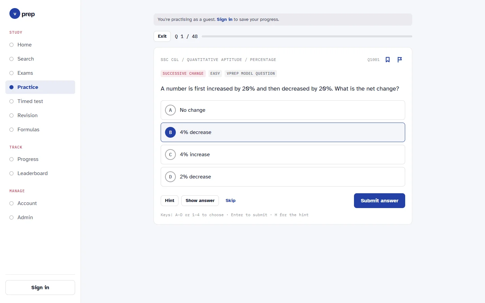

## Why VPrep

Most practice apps score a right answer the same way whether you worked it out, opened a hint first or looked at the answer. That makes scores look better than they are. VPrep records **how** each question was solved:

| Status        | What happened                          | Points |
| ------------- | -------------------------------------- | -----: |
| `independent` | Correct, without the hint              |     10 |
| `hint`        | Correct after opening the hint         |      6 |
| `revealed`    | Opened the answer instead of answering |      1 |
| `incorrect`   | Chose a wrong option                   |      0 |
| `skipped`     | Moved on without answering             |      0 |

- **Best attempt per question.** The leaderboard adds up each learner's best attempt on each published question, so answering the same question again can't pile up points.
- **Accuracy that means something.** Accuracy is (independent + hint) / (independent + hint + incorrect): revealed and skipped questions don't count either way. Progress also shows the share solved independently, and a dash when there is nothing to divide by yet.
- **The database keeps it honest.** Attempts can't be edited or deleted. A trigger rejects an attempt whose status doesn't match the option chosen, and sets the time itself, so streaks can't be back-dated.
- **Mistakes stay until they're fixed.** A question stays in the mistakes notebook until it is answered correctly after the latest wrong answer.

## Features

### For learners

- **Browse by goal and exam**, down to subjects, topics and subtopics, with question counts.
- **Practise** a topic, a subject or a whole exam. Options are OMR-style bubbles; use the hint, show the answer or skip. Keyboard shortcuts: A–D or 1–4 to choose, Enter to submit, H for the hint. Each answer is followed by the explanation and, where there is one, the formula it uses.
- **Similar questions** after a wrong answer or a revealed one: up to 3 published questions from the same exam that are closest in meaning, found with sentence embeddings (see [Similar questions with embeddings](#similar-questions-with-embeddings)). Questions you have already solved are left out, and **Practise these** starts a set of exactly those.
- **Practise as a guest**, with no account. Signing in saves every answer.
- **Timed tests**: 5, 10, 15 or all questions, picked at random, at 45, 60 or 90 seconds each. A refresh resumes the test with the same deadline. Answers and explanations appear after you submit.
- **What to study today**: Home suggests 3 topics to practise next and Progress shows 5, each with the reason it was picked ("2 mistakes to fix", "Last practised 9 days ago, time to review") and a Practise button. See [What to study today](#what-to-study-today).
- **Revision**: bookmarks in named lists, and a mistakes notebook with "Practise all open mistakes".
- **Formulas** grouped by subject, searchable, each linked to the questions that use it.
- **Search** every published question. Every word must match, partial words work ("prob" finds "probability"), and results can be filtered by exam, difficulty and type (practice or previous year), then practised as a set.
- **Progress**: how you solved your questions, today against your daily goal, current and best streak in your time zone, the last 14 days, accuracy by subject, a study plan with mastery bars, and "Needs work" and "Strong topics" lists.
- **Leaderboard**: global or by country for everyone, and by state once signed in.
- **Report a problem** with any question (wrong answer, unclear question or explanation, typo).
- **Account**: sign up with email and password, verify the email with a code, reset a forgotten password by code, and set your name, state and daily goal.
- **Works on phones** (bottom tab bar) and follows the system's dark mode.

<table>
  <tr>
    <td width="50%">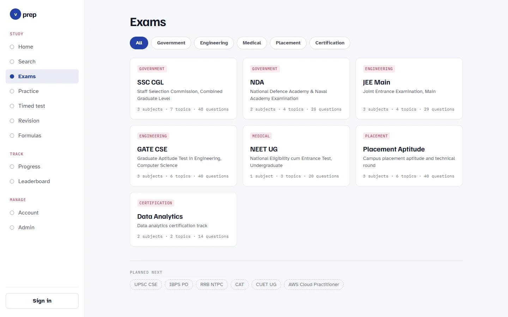</td>
    <td width="50%">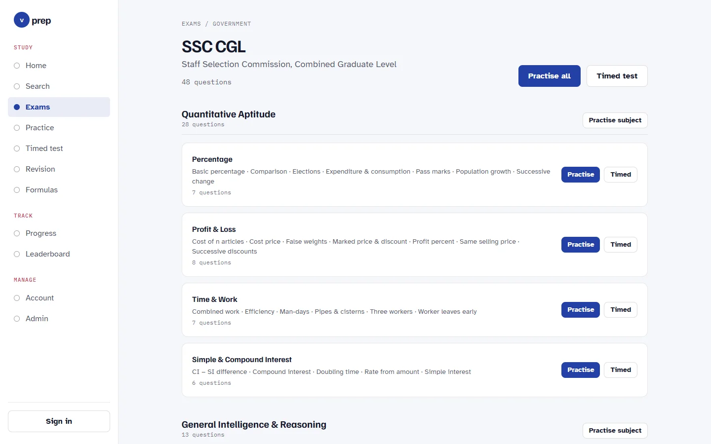</td>
  </tr>
  <tr>
    <td>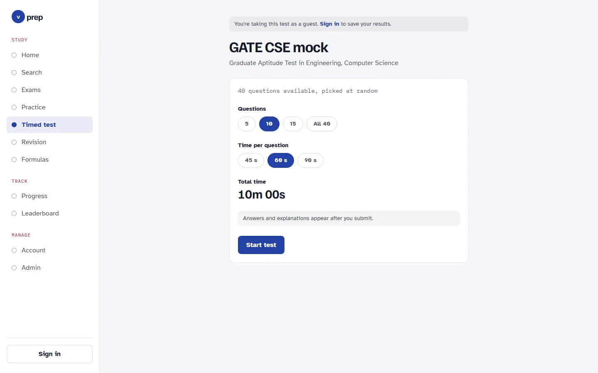</td>
    <td>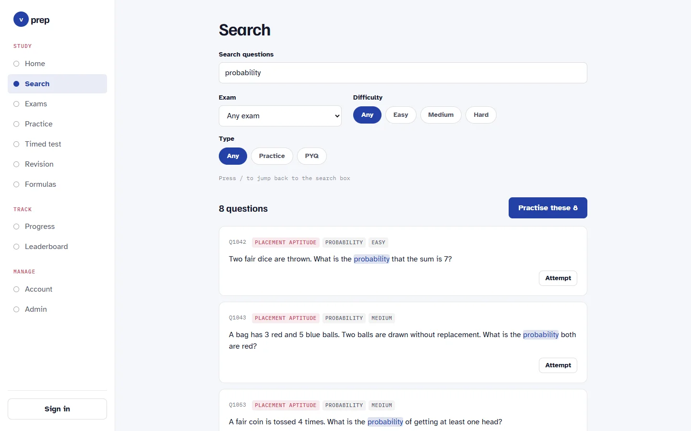</td>
  </tr>
  <tr>
    <td>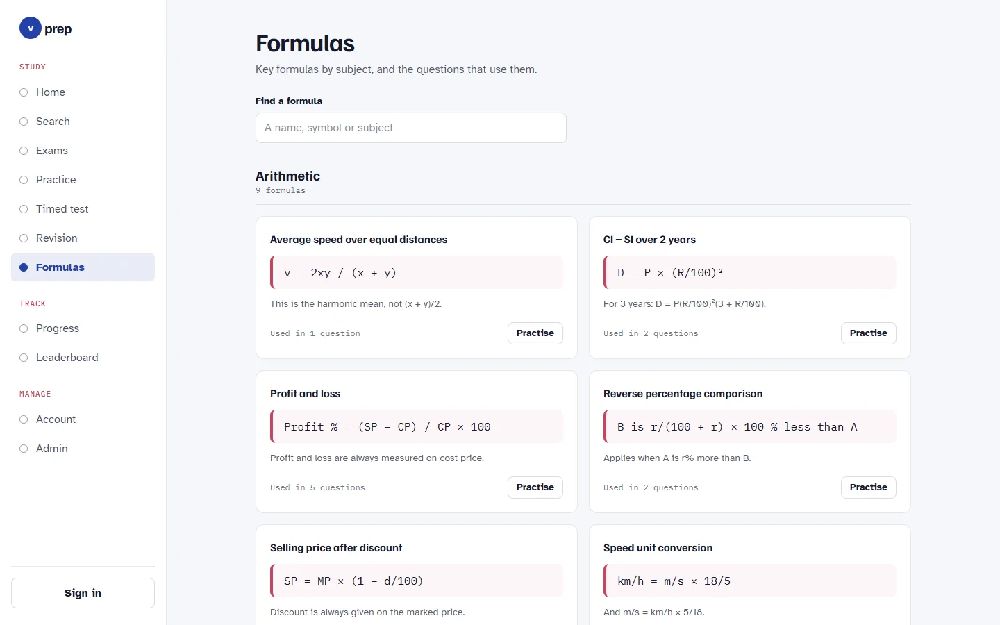</td>
    <td>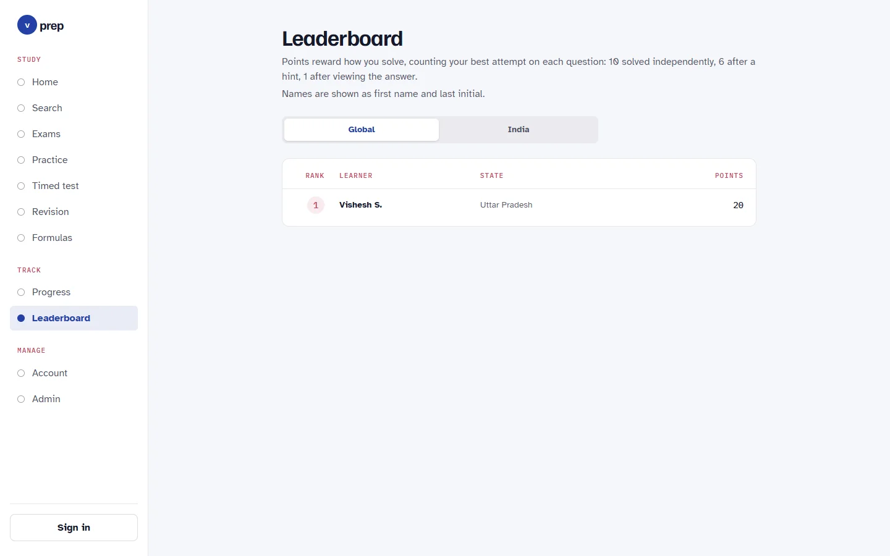</td>
  </tr>
  <tr>
    <td>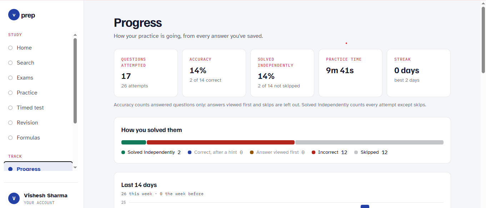</td>
    <td>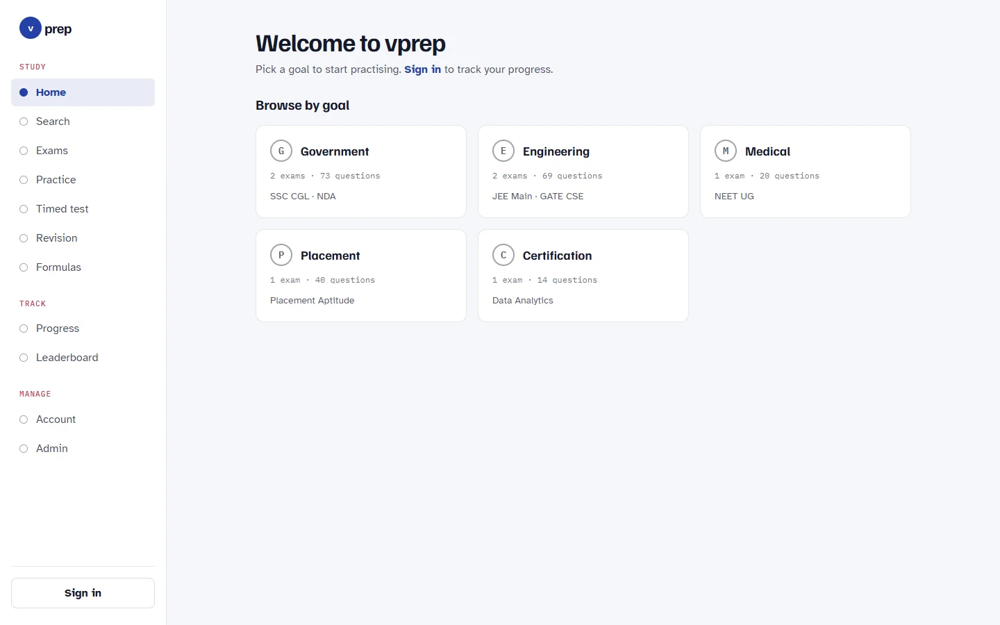</td>
  </tr>
</table>

<p>
  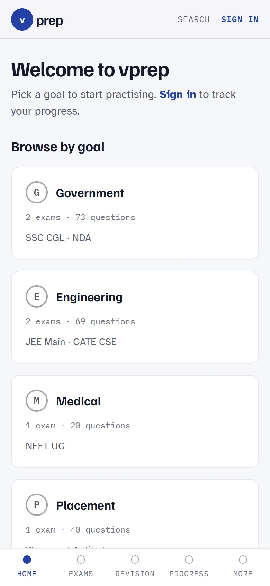
  &nbsp;
  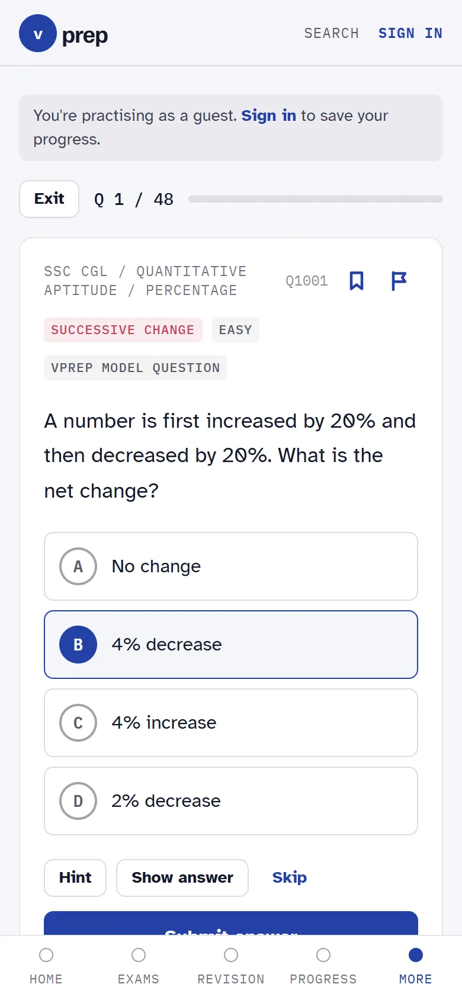
</p>

### For admins

- **Overview**: questions by status, open reports, explanation coverage, embedding coverage (with the command to run when some are missing or out of date), a difficulty check (the level set on each question against the one learners' answers give it) and questions per exam.
- **Question bank**: search, filter by exam and status, and sort by most reported or lowest accuracy to find questions that are wrong or too hard. A "Data says" column shows each question's difficulty as estimated from learners' first answers (see [Data-driven question difficulty](#data-driven-question-difficulty)).
- **Question editor** with a preview of the answered question. It checks the same rules as the database, and moves questions through draft, in review and published. A saved question also lists its 5 nearest questions in any exam and status, with 90% similar or more marked as a possible duplicate.
- **CSV import and export**: import up to 500 questions at once, checked row by row and saved all or nothing; export the whole bank. See [Importing and exporting questions](#importing-and-exporting-questions).
- **Exams, subjects and topics** as a tree, and a **formula manager**.
- **Reports** from learners, to resolve or dismiss.
- **Users**: search, suspend, or make someone an admin.
- A question that learners have attempted can't be deleted (it would erase their history); unpublish it instead.

<table>
  <tr>
    <td width="50%">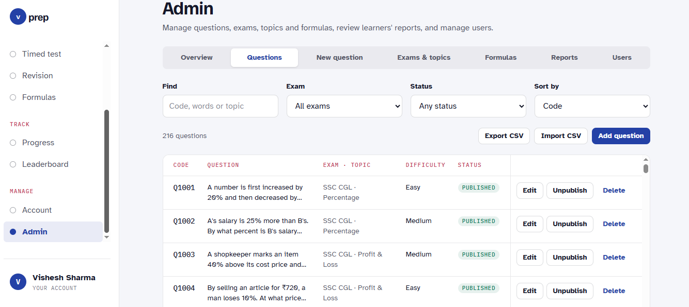</td>
    <td width="50%">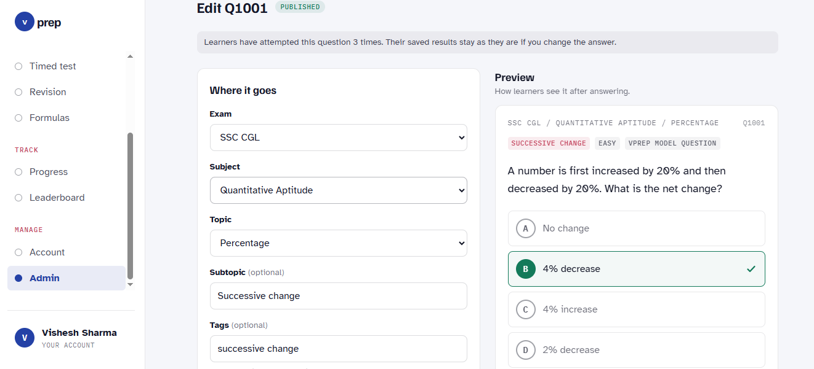</td>
  </tr>
</table>

## Content

The live site has **7 exams, 17 subjects, 32 topics, 216 questions and 27 formulas**, across five goals:

| Goal          | Exams                |
| ------------- | -------------------- |
| Government    | SSC CGL, NDA         |
| Engineering   | JEE Main, GATE CSE   |
| Medical       | NEET UG              |
| Placement     | Placement Aptitude   |
| Certification | Data Analytics       |

[`db/seed.sql`](db/seed.sql) holds the exams, subjects, topics, formulas and the first 54 questions (Q1001–Q1054). The rest were added after launch and are in the live database only, not in this repo.

## Tech stack

| Layer      | Choice |
| ---------- | ------ |
| Front end  | React 18, TypeScript, React Router 7; every page except Home is loaded on demand |
| Build      | Vite 8 |
| Styling    | Tailwind CSS v4 through `@tailwindcss/vite`; design tokens in `src/index.css` |
| Sign-in    | Neon Auth: email and password, email verification and password reset by code |
| Data       | Neon Data API (PostgREST-compatible), called from the browser with `@neondatabase/neon-js` |
| Database   | [Neon](https://neon.tech) Postgres: Row Level Security, SQL functions, views and triggers; pgvector for embeddings |
| ML         | Python 3 scripts run offline: sentence-transformers (`all-MiniLM-L6-v2`) for embeddings, scikit-learn for the TF-IDF baseline, NumPy and SciPy for the Rasch difficulty model, pytest |
| CSV        | Papa Parse |
| Hosting    | Vercel, with Vercel Web Analytics |
| Quality    | Vitest, oxlint, GitHub Actions |

## Architecture

There is no application server. The browser talks to Neon directly, and Postgres decides what each request may read or write.

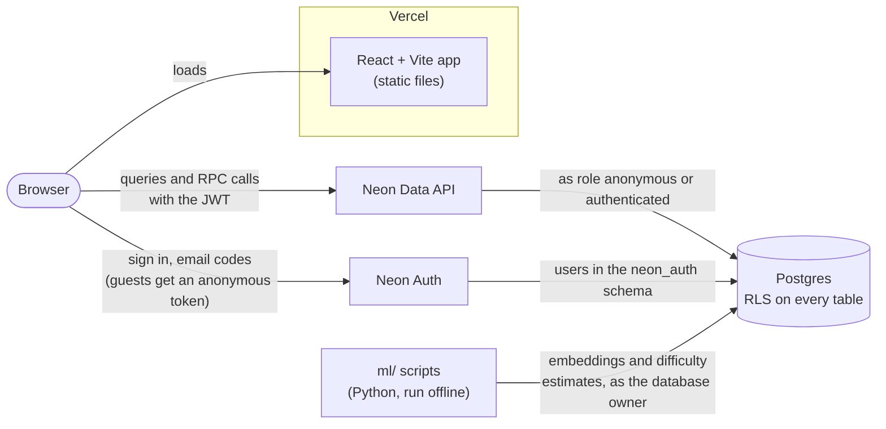

1. Vercel serves the built app. Every path outside `/assets/` gets `index.html`, so deep links work.
2. Neon Auth signs learners in and issues a JWT. Signed-out visitors get an anonymous token (`allowAnonymous: true` in [`src/lib/neon.ts`](src/lib/neon.ts)).
3. The Data API checks the JWT and runs each query as the `anonymous` or `authenticated` role. Row Level Security policies, table grants and SQL functions decide what comes back.
4. The scripts in [`ml/`](ml/) run on a developer's machine, not in the app. One writes a vector per question, and the app reads the nearest ones through SQL functions; another writes each question's estimated difficulty, which the admin panel reads.

## Security and data design

- **Row Level Security on every table.** All 11 tables have RLS turned on, with table grants as a second lock. Anyone can read exams, subjects, topics, formulas and **published** questions; drafts are admin-only. Attempts, bookmarks and reports are visible only to their owner (and admins). `question_embeddings` has no policies and no grants at all: only the owner (the embedding script) and the similar-question functions read it.
- **`SECURITY DEFINER` helpers, kept narrow.** `current_user_id()`, `is_admin()`, `is_active_user()`, `ensure_profile()`, `get_leaderboard()`, `admin_users()`, `admin_question_stats()`, `similar_questions()`, `admin_similar_questions()`, `admin_embedding_status()` and `recommend_topics()` run as the owner, with `search_path` set to `''`. The admin functions raise "Admins only" for anyone else, `similar_questions()` only ever returns published questions, and `recommend_topics()` is for signed-in learners only and reads nobody's attempts but the caller's. Views and the progress and search functions run with the caller's permissions, so RLS still applies.
- **Insert-only attempts.** Learners can insert and read their own attempts, never update or delete them. The `validate_attempt()` trigger allows attempts only on published questions, checks that a correct status has the correct option and an incorrect one a wrong option, and sets `created_at` itself.
- **Protected roles.** A trigger stops learners from changing their own role or suspension. Suspended accounts can't save attempts or file reports.
- **Leaderboard privacy.** The public leaderboard shows a short name ("Vishesh S.") and an `is_me` flag instead of full names and account ids, and leaves out learners with no points and suspended accounts (migration 0008).
- **Email verification.** Sign-up gives no session until the emailed code is entered. A password-reset request answers the same way whether or not the email has an account.
- **Open-redirect fix.** After signing in, the app returns to `?next=`. [`safeNext()`](src/auth/redirect.ts) only allows paths on this site, reading the value the way the browser does (tabs and newlines dropped, `\` taken as `/`), so links like `/\evil.example` or `/.//evil.example` go to Home. [`redirect.test.ts`](src/auth/redirect.test.ts) covers these cases.
- **Public keys only.** Both environment variables end up in the browser bundle. That is expected: the Data API is public, and the database decides what each request can see.

### Migrations

| Migration | What it adds |
| --------- | ------------ |
| [`0001_schema.sql`](db/migrations/0001_schema.sql) | Tables, RLS policies, grants, triggers, `my_mistakes` view, `get_leaderboard()` and helper functions |
| [`0002_catalog_views.sql`](db/migrations/0002_catalog_views.sql) | `topic_catalog` and `my_topic_progress` views, read by Home and Exams |
| [`0003_auth_debug.sql`](db/migrations/0003_auth_debug.sql) | `auth_debug()`, which the app calls to log why the database rejected a signed-in request |
| [`0004_fix_current_user_id.sql`](db/migrations/0004_fix_current_user_id.sql) | A fix so `current_user_id()` reliably sees the signed-in user |
| [`0005_my_progress.sql`](db/migrations/0005_my_progress.sql) | `my_progress()`, for the Progress page and Home |
| [`0006_search_formulas.sql`](db/migrations/0006_search_formulas.sql) | `search_questions()`, the `formula_catalog` view, and a leaderboard fix |
| [`0007_admin.sql`](db/migrations/0007_admin.sql) | `admin_users()` and `admin_question_stats()` for the admin panel, and a block on deleting questions that have attempts |
| [`0008_leaderboard_privacy.sql`](db/migrations/0008_leaderboard_privacy.sql) | A new `get_leaderboard()` for the public leaderboard: short names and `is_me` instead of full names and account ids, and no learners with 0 points |
| [`0009_similar_questions.sql`](db/migrations/0009_similar_questions.sql) | The pgvector extension, the `question_embeddings` table (384-dimensional vectors, HNSW index), `similar_questions()` for learners, and `admin_similar_questions()` and `admin_embedding_status()` for the admin panel |
| [`0010_study_plan.sql`](db/migrations/0010_study_plan.sql) | `recommend_topics()`, the "What to study today" ranking for Home and Progress (signed in only) |
| [`0011_study_plan_exact_cutoffs.sql`](db/migrations/0011_study_plan_exact_cutoffs.sql) | A fix to `recommend_topics()`: mastery and score are worked out in exact `numeric`, so a mastery of exactly 0.7 gets the 7-day interval (it was rounded to `real` first, just under 0.7) |
| [`0012_question_difficulty.sql`](db/migrations/0012_question_difficulty.sql) | The `question_difficulty` table (one Rasch estimate per question, written by `ml/fit_difficulty.py`, readable by no app role) and `admin_question_difficulty()`, which lists every question with the level set next to the estimated one |

## Quality

- **303 unit tests** in 23 files, run with [Vitest](https://vitest.dev). They sit next to the code they test (`src/lib/slug.test.ts` for `src/lib/slug.ts`) and run in Node with no `.env` and no network: [`src/test/setup.ts`](src/test/setup.ts) swaps the Neon client for a stand-in that fails any test that calls it.
- **12 Python tests** for the difficulty model, run with pytest ([`ml/tests/`](ml/tests/)): parameter recovery on a fixed-seed simulation, the gradient against finite differences, and the level rules. They need no database.
- **GitHub Actions** ([`ci.yml`](.github/workflows/ci.yml)) runs lint, tests and the production build on every push and pull request to `main`, and the Python tests in a second job that installs only NumPy, SciPy and pytest.
- **oxlint** with the React, TypeScript and oxc plugins ([`.oxlintrc.json`](.oxlintrc.json)).
- **TypeScript** type-checks the whole app as part of `npm run build`.

## Run locally

Requires Node.js `^22.12.0` or `>=24.0.0` (Vitest needs it for `npm test`). CI uses Node 22.

```bash
npm install
cp .env.example .env   # then fill in the two URLs below
npm run dev
```

If everything is set up, the Home page lists five goals (Government, Engineering, Medical, Placement, Certification) with their exam and question counts. If something is missing, it shows the error and a Retry button instead.

| Command           | What it does                         |
| ----------------- | ------------------------------------ |
| `npm run dev`     | Start the dev server with HMR        |
| `npm run build`   | Type-check, then build to `dist/`    |
| `npm run preview` | Serve the production build locally   |
| `npm run lint`    | Lint with oxlint                     |
| `npm test`        | Run the unit tests once with Vitest  |

### Environment variables

| Variable                 | Where to find it                        |
| ------------------------ | --------------------------------------- |
| `VITE_NEON_AUTH_URL`     | Neon Console -> your project -> **Auth** |
| `VITE_NEON_DATA_API_URL` | Neon Console -> your project -> **Data API** |

`.env` is gitignored, so don't commit it. [`src/lib/neon.ts`](src/lib/neon.ts) throws a clear error at startup if either variable is missing.

### Database setup

Do this once per Neon project, in the [Neon Console](https://console.neon.tech), in this order. The schema script checks that steps 1 and 2 are done and stops with a clear message if they aren't.

1. **Enable Neon Auth.** Open **Auth** and click **Enable Auth**.
2. **Enable the Data API.** Open **Data API**, tick **Use Neon Auth**, and click **Enable Data API**.
3. **Create the schema.** Open the **SQL Editor**, paste in all of [`db/migrations/0001_schema.sql`](db/migrations/0001_schema.sql) and run it. It runs in one transaction, so if it fails nothing is created and you can run it again after fixing the problem.
4. **Load the seed data.** Run all of [`db/seed.sql`](db/seed.sql): 7 exams with their subjects and topics, 27 formulas and 54 published questions. Run it only once: a second run fails on duplicate slugs and changes nothing.
5. **Run migrations 0002–0012**, each file in full, once, in order (see [Migrations](#migrations)), then refresh the schema cache (see below). `0009` turns on the pgvector extension, which Neon has built in.
6. **Embed the questions**, for similar questions: see [`ml/README.md`](ml/README.md). Until this runs, learners get no similar questions and the admin Overview shows every question as missing an embedding.
7. **Fit question difficulty** with `ml/fit_difficulty.py` once learners have answered, and again from time to time. Until then the admin panel shows no estimates.

The full order is: `0001_schema.sql`, `seed.sql`, then `0002` to `0012`, then `ml/embed_questions.py` (and later `ml/fit_difficulty.py`).

> [!IMPORTANT]
> **Refresh the schema cache after every migration**, including `0001` and any you run later: in the Neon Console open **Data API** and click **Refresh schema cache**. Until you do, the Data API doesn't know about new or changed functions, and calling one fails with "Could not find the function ... in the schema cache".

> [!CAUTION]
> **Never run the scripts in [`db/cleanup/`](db/cleanup/).** They were one-off scripts for removing test data before launch. They delete every question above Q1054, every problem report, and every exam, subject, topic and formula that isn't in `seed.sql`. Real questions on the live site start at Q1056, so running them now would delete real content. They are kept only as a record.

To make yourself an admin, sign in once (that creates your profile), then run this in the SQL Editor:

```sql
update public.profiles set role = 'admin'
where id = (select id from neon_auth."user" where email = 'you@example.com');
```

## Deploy to Vercel

1. **Import the repo** in Vercel. It detects Vite: the build command is `npm run build` and the output directory is `dist`.
2. **Set the environment variables.** In the project's **Settings -> Environment Variables**, add `VITE_NEON_AUTH_URL` and `VITE_NEON_DATA_API_URL`, with the same values as in `.env`. Vite writes them into the bundle at build time, so after adding or changing one, redeploy. If either is missing, the deployed site is a blank page and the browser console shows the error from `src/lib/neon.ts`.
3. **Allow the domain in Neon Auth.** In the Neon Console, open **Auth -> Configuration -> Domains** and add the Vercel domain (for example `https://vprep-umber.vercel.app`). Until you do, sign-in and sign-up fail on the deployed site. Preview deployments have their own URLs; add those too if you want to sign in on them.
4. **Turn on Web Analytics.** In the Vercel project, open **Analytics** and click **Enable**. The app renders `<Analytics />` from `@vercel/analytics` in production builds only, so `npm run dev` sends nothing.

**Link previews.** `index.html` has Open Graph and Twitter tags pointing at `https://vprep-umber.vercel.app/og-image.png`; change those URLs if the domain changes. The image, [`public/og-image.png`](public/og-image.png), is a headless Chrome screenshot of [`scripts/og-image.html`](scripts/og-image.html); the command to make it again is at the top of that file.

[`vercel.json`](vercel.json) does two things:

- **Deep links work.** Every path outside `/assets/` is served `index.html`, so opening `/exams/ssc-cgl` or `/admin?tab=users` directly (or reloading on it) loads the app, which then shows that page. Unknown paths show the app's Page not found page.
- **Built files are cached for a year.** Files in `/assets/` have a content hash in their name, so they get `Cache-Control: public, max-age=31536000, immutable`. `index.html` keeps Vercel's default (revalidate on every visit), so a new deploy shows up on the next page load.

If a learner has the site open during a deploy and opens a page that hasn't loaded yet, its old file may be gone; the page shows "Couldn't load this page" and Retry reloads the app.

## Importing and exporting questions

On the admin **Questions** tab, **Export CSV** downloads every question, and **Import CSV** adds up to 500 from a file. The template (**Download template** on the import screen) has the columns:

`exam, subject, topic, subtopic, difficulty, type, year, source, question, option_a … option_f, answer, hint, explanation, formula, tags, status`

- `exam`, `subject`, `topic`: the slug or exact name (any case) of an existing exam, subject and topic.
- `option_a` … `option_f`: 2 to 6 options, filled in from `option_a` with no gaps. `answer` is the correct option's letter.
- `difficulty`: `easy`, `medium` (the default) or `hard`. `type`: `practice` (the default) or `pyq`, which needs a `year`. `status`: `draft` (the default), `in_review` or `published`, which needs an `explanation`.
- `formula`: a formula's slug. `tags`: separated by semicolons.

An exported file has a `code` column first, which import ignores, and a UTF-8 BOM so Excel shows Hindi and ₹ correctly; save from Excel with **Save As -> CSV UTF-8**. Every row is checked with the editor's rules before anything is saved, a question already in the bank or repeated in the file is flagged, and the import is one request, so it adds all the rows or none.

## Machine learning

Three features learn from the question bank and from learners' answers: similar questions, from sentence embeddings; a study plan, from a scoring model over each learner's attempt history; and question difficulty, from an item response model over everyone's first answers.

### Similar questions with embeddings

After a wrong or revealed answer, VPrep suggests questions that are about the same thing, even when they share few words. It does this with sentence embeddings stored in Postgres.

1. **Embed offline.** [`ml/embed_questions.py`](ml/embed_questions.py) turns each question's text and options (not its topic name) into a 384-number vector with [`all-MiniLM-L6-v2`](https://huggingface.co/sentence-transformers/all-MiniLM-L6-v2), normalised, and upserts it into `question_embeddings`. It stores an md5 of the model name and the text, so later runs only embed new and changed questions.
2. **Search in the database.** `similar_questions()` ranks the other published questions in the same exam by cosine similarity with pgvector's `<=>`, drops matches below 0.3 rather than padding the list, and leaves out questions the signed-in learner has already solved. It works signed out too.
3. **Show it.** The practice screen loads up to 3 in the background once a question is answered wrong or revealed, and hides the card when there are none. Admins see each saved question's 5 nearest neighbours in the editor, to catch duplicates, and the Overview shows how many questions are missing an embedding or changed since theirs was made.

**Does it work?** [`ml/evaluate_similarity.py`](ml/evaluate_similarity.py) takes each published question's 3 nearest neighbours in its exam, as the app does, and measures how many share its topic and its subject (precision@3), for the stored embeddings against a TF-IDF baseline on the same text and against chance. Because the topic name is never embedded, a high score means questions find their topic from their content alone. On the 216 published questions (October 2026):

| Method | Precision@3, same topic | Precision@3, same subject |
| ------ | ----------------------: | ------------------------: |
| Chance (random questions from the same exam) | 19.7% | 43.9% |
| TF-IDF baseline | 76.1% | 90.4% |
| MiniLM embeddings | **92.1%** | **96.9%** |

With the app's 0.3 cut-off, 213 of the 216 questions get at least one suggestion (2.8 on average), and 93.1% of the suggestions shown are from the same topic. Details: [`ml/results.md`](ml/results.md).

To set up the Python environment and run the scripts, see [`ml/README.md`](ml/README.md).

### What to study today

Home's **Today's plan** card shows the top 3 topics to practise next, and Progress's **Study plan** the top 5, with a mastery bar each. The ranking is one SQL function, `recommend_topics()` ([`0010`](db/migrations/0010_study_plan.sql), with exact cut-offs since [`0011`](db/migrations/0011_study_plan_exact_cutoffs.sql)), and it is explainable on purpose: it returns every number it used, and the app turns them into the reason shown under each topic ([`src/lib/studyPlan.ts`](src/lib/studyPlan.ts)).

For each topic a learner has answered, using the latest non-skipped answer to each published question:

```text
mastery  = (credit + 1) / (answered + 2)     credit: independent 1, hint 0.6, incorrect or revealed 0
interval = 1, 3, 7 or 14 days                for mastery < 0.5, < 0.7, < 0.85, and above
overdue  = days since last practice / interval
score    = 0.5 × (1 − mastery) + 0.3 × min(overdue, 2) / 2 + 0.2 × min(open mistakes, 3) / 3
```

- **Mastery** is the mean of a Beta(1, 1) posterior, i.e. Laplace smoothing: one right and one wrong answer are assumed before any real ones, so a single answer puts a topic at 33% or 67%, not 0% or 100%, and the estimate firms up as answers add up.
- **Review intervals** are spaced repetition: the better a topic is known, the longer it can wait. `overdue` reaches 1 when the interval has passed and counts up to 2.
- **Open mistakes** are wrong answers not solved correctly since, as in Revision, counting up to 3.
- **Kind**, which picks the reason shown: `mistakes` if there are open mistakes, else `weak` below 0.6 mastery, else `due` once overdue, else `review`.
- **New topics** not answered yet, in exams the learner already practises, score a flat 0.2. Any topic below 0.6 mastery scores more, so weak topics always come first, and new material moves up as the rest gets stronger and recently practised.

Days are counted in the browser's time zone, the same one the Progress page uses. The plan reloads after every new attempt, like the rest of the progress numbers.

**The weights are set by hand**, not learned: 0.5, 0.3 and 0.2, the 0.6 credit for a hint, and the 1/3/7/14-day intervals are reasonable starting points. With enough attempt history they could be fitted instead, for example by training a model to predict whether a learner's next answer in a topic will be correct from mastery, days since practice and open mistakes, and ranking topics by the predicted chance of a wrong answer. It could be checked offline like similar questions: hold out each learner's latest answers and compare against the hand-set score.

### Data-driven question difficulty

Admins set each question's difficulty by hand. VPrep checks those levels against how learners actually do, with a Rasch model (one-parameter item response theory) fitted offline by [`ml/fit_difficulty.py`](ml/fit_difficulty.py).

**The model.** Each learner has an ability θ and each question a difficulty b, both in logits:

```text
P(learner u answers question q correctly) = σ(θ_u − b_q)        σ(x) = 1 / (1 + e^(−x))
```

Because ability is in the model, difficulty is comparable across learners: an easy question answered mostly by weaker learners isn't mistaken for a hard one, as it would be by percent correct alone.

**Fitting.** [`ml/rasch.py`](ml/rasch.py) finds the MAP estimate, the most likely abilities and difficulties given the answers and the priors, with SciPy's L-BFGS and an analytic gradient (checked against finite differences in the tests).

- **Priors:** ability ~ N(0, 1), difficulty ~ N(0, 2²). The ability prior fixes the scale, so a difficulty of 0 means an average learner has a 50% chance, and keeps a learner or question with all-right or all-wrong answers from running off to infinity. The difficulty prior is wider, so the data decides.
- **Standard error:** 1 / √(Σ p(1 − p) + 1/2²), summed over the question's answers: the curvature of the posterior in b, with abilities held at their estimates.
- **p_average** = σ(−b): the chance an average learner gets it right.

**Why first answers only.** For each learner and question, only the first attempt counts: solved alone is 1, wrong or revealed is 0. A first attempt with a hint or skipped is left out, and not replaced by the next one. Every attempt is followed by the correct answer and its explanation (in the feedback, or on the summary at the end of the session, skipped questions included), so a second attempt measures whether the learner remembers the explanation, not how hard the question is. Counting it would make questions look easier the more they are practised.

**Levels.** A question with at least 20 first answers gets one: **easy** if p_average ≥ 0.7, **hard** below 0.4, **medium** in between. With fewer it gets none: at 20 answers the standard error is still about 0.5 logits. The admin Questions tab shows a "Data says" column ("Hard · 40 answers", or "—" until a question has 20), and the Overview's **Difficulty check** card shows a set-vs-estimated table, the number of mismatches and the biggest ones (two levels apart first), each linking to the editor. The script replaces every row of `question_difficulty` ([`0012`](db/migrations/0012_question_difficulty.sql)) in one transaction, with model `rasch-map-v1`; `--dry-run` prints the same summary without writing.

**Does it work?** There is too little real data to say yet, so [`ml/simulate_difficulty.py`](ml/simulate_difficulty.py) checks parameter recovery on simulated learners: 216 questions with the real bank's set levels (121 easy, 85 medium, 10 hard), true difficulties drawn around −1, 0 and +1 logits for easy, medium and hard (sd 0.5), abilities from N(0, 1), and every learner answering a random 30% of the questions. Averaged over 5 seeds:

| Learners | First answers per question | Pearson r | Spearman ρ | RMSE | With a level | Level accuracy | Mean SE | 95% coverage |
| ---: | ---: | ---: | ---: | ---: | ---: | ---: | ---: | ---: |
| 30 | 9.0 | 0.702 | 0.690 | 0.786 | 0.0% | — | 0.765 | 94.4% |
| 100 | 30.1 | 0.871 | 0.871 | 0.474 | 99.2% | 71.7% | 0.427 | 92.2% |
| 300 | 90.3 | **0.949** | **0.944** | 0.273 | 100.0% | **83.2%** | 0.245 | 91.9% |

Level accuracy is the share of questions with a level that get the level their true difficulty gives. The 95% intervals cover a little less than 95% because the standard error treats the abilities as known. And because levels and true difficulty overlap in the simulation, even the exact difficulties give only 70% of questions their set level: a mismatch is a reason to look at a question, not proof that its level is wrong. Details: [`ml/difficulty_results.md`](ml/difficulty_results.md).

**Limitation: it needs real data.** In October 2026 the live site has one learner with 11 usable first answers, so the fit runs but no question has a level yet. By the simulation, about 100 learners each answering a third of the bank would give nearly every question one, with about 72% of levels right; 300 would get about 83%. The model also gives each learner one ability across every exam and topic, which fitting each exam separately would relax once there are answers enough.

## Project structure

```
.github/
  workflows/     ci.yml: lint, test and build, and the ML tests, on push and pull request
db/
  migrations/    0001_schema.sql to 0012_question_difficulty.sql, run in order
  cleanup/       One-off pre-launch scripts. Never run them again
  seed.sql       Exams, subjects, topics, formulas, the first 54 questions
docs/
  screenshots/   README screenshots
ml/              Python, run offline (own venv in ml/.venv, settings in ml/.env)
  embed_questions.py      Embeds new and changed questions into question_embeddings
  evaluate_similarity.py  Precision@3 of the embeddings vs TF-IDF, written to results.md
  common.py               Database connection and the text that gets embedded
  rasch.py                The Rasch model and its MAP fit (numpy and scipy only)
  fit_difficulty.py       Fits it to first answers and replaces question_difficulty
  simulate_difficulty.py  Parameter recovery on simulated learners, written to difficulty_results.md
  tests/                  pytest tests for rasch.py
scripts/
  og-image.html  Template for public/og-image.png, the link preview image
  screenshots.mjs  Takes the README screenshots with headless Chrome
src/
  components/
    ui/          Button, Card, Tag, Bubble (OMR-style option circle), Notice,
                 Disclosure, Tabs, FilterChips, form fields, Skeleton, icons
    layout/      AppShell (sidebar on desktop, bottom tab bar on mobile),
                 PageHeader, nav config, ErrorBoundary
    practice/    QuestionScreen, OptionList, Summary, status labels and colours,
                 SimilarQuestions, BookmarkButton, ReportProblem, GuestNotice
    test/        TestSetup, TestRunner, TestResult (timed tests)
    progress/    GoalBubbles (daily goal), Percent, StudyPlan (topics to study next)
    account/     RegionSelect (state picker)
    admin/       AdminOverview, QuestionList, QuestionEditor, QuestionPreview,
                 SimilarQuestionsPanel (near-duplicates),
                 QuestionImport (CSV import with preview), TaxonomyTree
                 (exams > subjects > topics), FormulaManager, ReportList,
                 UserList, ScrollTable (table with pinned actions)
  pages/         One component per route
  lib/           neon.ts (Neon client), attempts.ts (statuses and saving),
                 session.ts (token refresh), timedTest.ts (saved test state),
                 questionCsv.ts (CSV import and export), questions.ts,
                 taxonomy.ts and formulaForm.ts (the database's rules, checked
                 in the forms), similar.ts (similarity and embedding coverage),
                 difficulty.ts (estimated levels and mismatches),
                 studyPlan.ts (the reason shown for each study-plan topic),
                 search.ts, reports.ts, format.ts and helpers
  types/         One interface per table, view and function result,
                 plus a union type for every CHECK constraint
  auth/          AuthProvider, useAuth, RequireAuth, SessionExpiredDialog,
                 redirect.ts (signInHref, safeNext)
  hooks/         Data hooks: useExamCatalog, useTopicProgress, useMyProgress,
                 useStudyPlan, usePracticeSet, useSimilarQuestions, useBookmarks,
                 useLeaderboard, useSearchQuestions, useAdminQuestions,
                 useAdminCatalog, useAdminEmbeddings, useAdminDifficulty, …
  test/          Test setup (Neon client stand-in) and fixtures
  App.tsx        Router; every page except Home is loaded on demand
  index.css      Tailwind import + design tokens
vercel.json      SPA rewrite and cache headers for Vercel
```

## Routes

| Path             | Page        |
| ---------------- | ----------- |
| `/`              | Home        |
| `/exams`         | Exams       |
| `/exams/:slug`   | ExamDetail  |
| `/practice`      | Practice: one of `?topic=<id>`, `?subject=<id>`, `?exam=<slug>`, `?ids=<id,id,…>`, `?q=<id>` |
| `/test`          | TimedTest: `?topic=<id>`, `?subject=<id>` or `?exam=<slug>` |
| `/result`        | Result      |
| `/revision`      | Revision (signed in): bookmarks, or `?tab=mistakes` |
| `/formulas`      | Formulas    |
| `/progress`      | Progress (signed in) |
| `/leaderboard`   | Leaderboard, open to signed-out visitors: Global, `?scope=country`, or `?scope=state` (signed in) |
| `/search`        | Search: `?q=`, with `exam`, `difficulty` and `type` filters |
| `/admin`         | Admin (admins only, loaded on demand): `?tab=overview`, `?tab=questions` (with `q`, `exam`, `status`, `sort`; `?tab=questions&view=import` for the CSV import), `?tab=edit` for a new question or `?tab=edit&id=<id>`, `?tab=taxonomy` (exams and topics), `?tab=formulas`, `?tab=reports`, `?tab=users` |
| `/account`       | Account     |

Any other path shows Page not found.

## Design tokens

Tokens are defined with `@theme` in `src/index.css`. Each one is a CSS variable (`var(--color-pen)`) and a Tailwind utility (`bg-pen`, `text-drop/80`). Dark mode follows the OS `prefers-color-scheme` setting.

| Token   | Light     | Dark      | Use                                |
| ------- | --------- | --------- | ---------------------------------- |
| `paper` | `#f5f6fa` | `#10121b` | Page background                    |
| `sheet` | `#ffffff` | `#171a26` | Cards and surfaces                 |
| `ink`   | `#151829` | `#e7e8f0` | Text                               |
| `drop`  | `#c4465f` | `#ee8aa0` | Structure and labels (rose)        |
| `pen`   | `#2441a6` | `#8fa3ff` | User actions (ballpoint blue)      |
| `ok`    | `#137a5a` | `#4cc49a` | Correct / success                  |
| `bad`   | `#b3261e` | `#f2867c` | Incorrect / error                  |
| `warn`  | `#935605` | `#e3a64f` | Warnings                           |

Fonts (Google Fonts, loaded in `index.html`):

- `font-display`: Familjen Grotesk, for headings (applied to `h1`–`h6` automatically)
- `font-sans`: Atkinson Hyperlegible, for body text (the default)
- `font-mono`: IBM Plex Mono, for labels, numbers and timers

## Screenshots

The screenshots of public pages in [`docs/screenshots/`](docs/screenshots/) come from [`scripts/screenshots.mjs`](scripts/screenshots.mjs), which drives headless Chrome, signed out, at 1440 × 900 on desktop and 390 × 844 on a phone. It needs Node 22+ and Chrome, and no npm packages:

```bash
node scripts/screenshots.mjs                         # from the live site
node scripts/screenshots.mjs http://localhost:5173   # from a local server
```

Pages that need sign-in are captured by hand at 1440 × 900 and saved under the same names: `progress.png`, `admin-questions.png` and `admin-editor.png`. Keep each file under 300 kB.

## Known limitations and roadmap

- **Answers are checked in the browser.** Each question is downloaded with its correct option, and the app works out the status before saving it. The database rejects a status that doesn't match the option chosen, but it can't tell whether someone read the answer from the network response first. **Planned:** grade answers on the server, with a function that takes the chosen option and returns the result, and stop sending `answer_index` with unanswered questions.
- **Embeddings and difficulty estimates are updated by hand.** A new or edited question gets no similar questions (and its old text is still what's compared) until someone runs `ml/embed_questions.py`; the admin Overview shows when that's due. Difficulty estimates likewise stay as they were at the last `ml/fit_difficulty.py`. **Planned:** run both on a schedule, for example a GitHub Actions job with the connection string as a secret.
- **Next for the machine learning layer** (similar questions, the study plan and difficulty estimates are done, above):
  - **Learned study-plan weights**, fitted to how learners actually do on their next answer in a topic instead of set by hand.
  - **Adaptive practice.** The Rasch fit puts learners and questions on one scale, so practice could pick questions a learner has about a 70% chance of getting right, once there are enough answers to trust the estimates.

## Author

**Vishesh Sharma**, B.Tech Computer Science and Engineering, SRM Institute of Science and Technology, Delhi NCR.

- LinkedIn: [linkedin.com/in/visheshsharma14](https://www.linkedin.com/in/visheshsharma14)
- GitHub: [@vishesharma14](https://github.com/vishesharma14)
